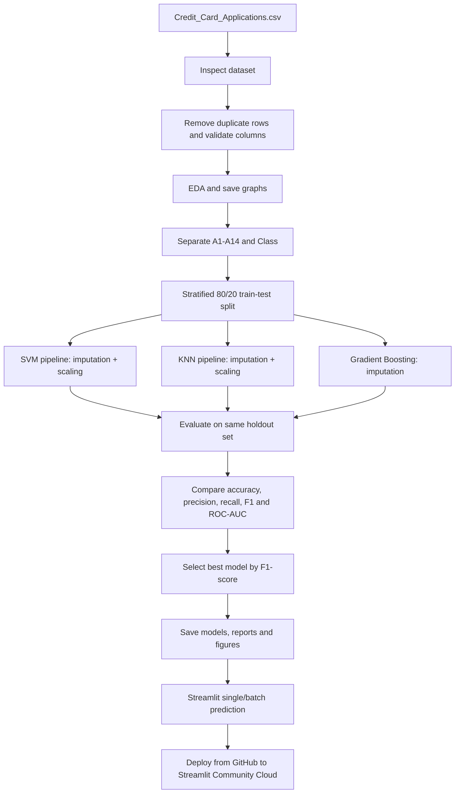

# Credit Card Application Prediction

A deployable educational machine-learning project using the supplied `Credit_Card_Applications.csv` dataset and exactly three classifiers: **SVM, KNN and Gradient Boosting**.

> **Dataset note:** This is an application-record classification dataset with 690 rows, 16 columns, features `A1`–`A14`, identifier `CustomerID`, and target `Class`. It is not a transaction fraud dataset. The code displays `Class 0` and `Class 1`; confirm the original dataset documentation before calling either label approved or rejected.

## Prediction flow



## Folder structure

```text
Credit_Card_Application_Prediction/
├── data/
│   ├── raw/Credit_Card_Applications.csv
│   └── processed/credit_card_applications_processed.csv
├── models/
│   ├── svm_model.pkl
│   ├── knn_model.pkl
│   ├── gradient_boosting_model.pkl
│   ├── best_model.pkl
│   └── best_model_info.json
├── outputs/
│   ├── figures/
│   │   ├── application_approval_distribution.png
│   │   ├── applicant_feature_correlation.png
│   │   ├── approval_prediction_confusion_matrices.png
│   │   ├── algorithm_performance_comparison.png
│   │   └── gradient_boosting_feature_importance.png
│   ├── model_comparison.csv
│   ├── svm_classification_report.txt
│   ├── knn_classification_report.txt
│   └── gradient_boosting_classification_report.txt
├── src/
│   ├── inspect_data.py
│   ├── prepare_data.py
│   ├── eda.py
│   ├── train.py
│   ├── evaluate.py
│   └── test_model.py
├── app.py
├── README.md
├── requirements.txt
└── .gitignore
```

## Run in VS Code (Windows PowerShell)

```powershell
py -m venv .venv
.venv\Scripts\Activate.ps1
pip install -r requirements.txt
python src/inspect_data.py
python src/prepare_data.py
python src/eda.py
python src/train.py
python src/evaluate.py
python src/test_model.py
streamlit run app.py
```

The app opens in your browser. For future retraining, repeat the inspection/preparation/EDA/training/evaluation commands after replacing the raw CSV.

## Deployment on Streamlit Community Cloud

1. Create a GitHub repository and upload this project.
2. Push the files to the repository's `main` branch.
3. In Streamlit Community Cloud, choose **Create app**.
4. Select the repository, branch `main`, and main file `app.py`.
5. Deploy. `requirements.txt` installs the app dependencies.

Keep the dataset's original attribution/license when publishing it. If you are not permitted to redistribute the CSV publicly, remove it from the public repository and provide it through an authorized private data source instead.

## Method notes and limitations

- `CustomerID` is excluded from model features to avoid learning from an identifier.
- Missing feature values are median-imputed inside each model pipeline; SVM and KNN also use standard scaling.
- A stratified 80/20 holdout split with fixed random seed 42 is used for comparable evaluation.
- The best model is selected using F1-score, with ROC-AUC and accuracy as tie-breakers.
- Gradient Boosting supplies the model-native feature-importance chart.
- This small historical dataset is for coursework/demo use, not a production credit decision. Real deployment requires data provenance checks, external validation, fairness/bias testing, privacy/security controls and human oversight.
